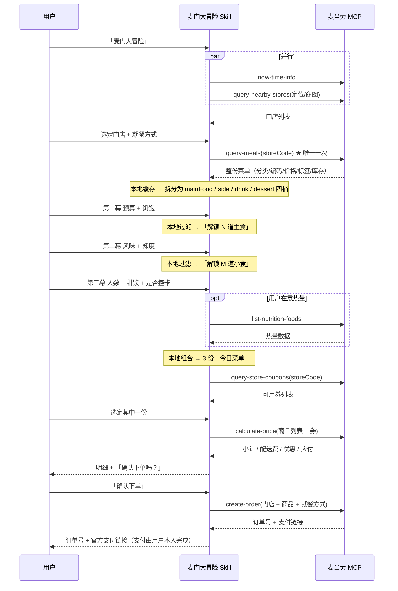

# MCP 集成说明

本文档说明「麦门大冒险」**实际使用了哪些麦当劳 MCP 能力、如何编排调用、为什么这样编排**，以及它对点餐业务的价值。

---

## 1. MCP Server

| 项 | 值 |
|---|---|
| Server 名称 | `mcd-mcp` |
| 接入地址 | `https://mcp.mcd.cn` |
| 传输协议 | Streamable HTTP |
| 鉴权 | `Authorization: Bearer <MCD_MCP_TOKEN>` |
| 限流 | 600 次/分钟（超限返回 `429`） |
| 覆盖业务 | 麦乐送点餐、到店取餐、团餐、积分兑换券、活动日历 |

---

## 2. 使用的 Tools

### 核心链路（一次完整冒险 = 4~6 次调用）

| # | Tool | 用途 | 调用次数 | 必要性 |
|---|---|---|---:|---|
| 1 | `now-time-info` | 判断当前时段（早餐 / 正餐 / 夜宵），决定是否提示「现在早餐菜单不同」 | 1 | 必需 |
| 2 | `query-nearby-stores` | 定位或用户输入商圈，返回附近门店（含 `storeCode`） | 1 | 必需 |
| 3 | `query-meals` | **查门店在售菜单**（分类、餐品编码、价格、标签、售罄状态） | **1（唯一）** | **核心** |
| 4 | `query-store-coupons` | 查当前门店可用券，用于「性价比型」方案 | 1 | 必需 |
| 5 | `calculate-price` | 计算商品小计 / 配送费 / 优惠 / 应付总额 | 1 | 必需 |
| 6 | `create-order` | 创建订单，返回订单详情与支付链接 | 0 或 1 | **条件触发** |
| 7 | `list-nutrition-foods` | 补充餐品热量，仅在用户选择「在意热量」时 | ≤1 | 可选 |
| 8 | `query-meal-detail` | 查套餐组成与可替换项，仅在用户要求换单品时 | ≤2 | 可选 |

### 外送场景额外

| Tool | 用途 |
|---|---|
| `delivery-query-addresses` | 查询用户已有收货地址 |
| `delivery-query-stores` | 查询该地址可配送门店 |

### 下单后按需

| Tool | 用途 |
|---|---|
| `query-order` | 查订单状态 |
| `cancel-order` | 用户主动要求时取消 |

> **明确不使用的 Tools**：商城（`mall-*`）、抽奖（`draw-lottery`）、派对（`party-*`）、团餐（`query-meal-assistance`）。它们与本 Skill「帮一个人决定今天吃什么」的定位无关，调用只会增加限流风险。

---

## 3. 调用时序



### 为什么 `query-meals` 只调一次

这是整个设计里最关键的取舍：

| 若每题都请求 | 本方案 |
|---|---|
| 6 个问题 ≈ 6 次菜单请求 + 重试，撞 429 风险高 | 全程 1 次 |
| 每答一题等一次网络往返，3 分钟变 10 分钟 | 答完即出，本地计算微秒级 |
| 用户中途回头改答案 → 又一轮请求 | 改答案零成本，重新本地计算即可 |
| 门店菜单在会话中途变动 → 前后矛盾 | 以首次快照为准，反而更一致 |

---

## 4. 数据归一化

麦当劳 MCP 返回的原始结构需要做一层适配，才能进入打分引擎（`scripts/build_pool.mjs`）：

| 原始字段 | 兼容处理 | 归一后 |
|---|---|---|
| `category` / `categoryName` | 优先用分类名判定桶 | `bucket: mainFood \| side \| drink \| dessert` |
| `price` / `unitPrice` / `salePrice` | 若数值 `> 1000` 视为「分」，自动 `/100` | `price`（元） |
| `tags` / `tag` | 兼容 `["辣"]` 与 `[{name:"辣"}]` 两种形态 | `tags: string[]` |
| `kcal` / `energy` / `calorie` | 三者取其一 | `kcal: number \| null` |
| `status` / `soldOut` / `available` | `SOLD_OUT`、`soldOut:true`、`available:false` 均判为售罄 | 售罄项**直接剔除**，不进候选池 |
| `code` / `mealCode` / `id` | 逐级回退 | `code: string` |

无法归入任何桶的餐品**直接丢弃**，不猜测——宁可少推荐，也不乱推荐。

---

## 5. 降级策略

| 故障 | 表现 | 处理 |
|---|---|---|
| 无 Token / `401` | 工具调用失败 | 引导至 README 配置章节；同时提供**演示模式**（读取 `assets/sample-menu.json`）并明确标注「快照数据，非实时」 |
| 定位失败 | 拿不到坐标 | 请用户输入商圈名 / 地铁站 / 门店名；仍失败则改走外送 `delivery-query-addresses` |
| 门店菜单为空 / 已打烊 | `query-meals` 返回空 | 列出 3 家替代门店让用户换，或改外送 |
| 菜品售罄 / 价格变动 | 错误码返回 | 剔除该项、本地重排、明确告知「XX 已售罄，已为你替换为 YY」 |
| 优惠券不可用 | 券校验失败 | 不阻塞下单流程，回落原价，在明细中注明「券不可用，按原价计算」 |
| `429` 限流 | 超 600 次/分钟 | 退避 ≥2s 重试 1 次；仍失败则走本地缓存并提示稍后再试 |
| `create-order` 失败 | 下单报错 | 保留购物清单、告知原因，**不自动重试**（避免重复下单） |
| 预算过低 | 全部组合超预算 | 取最便宜组合并打上 `overBudget` 标记，如实告知「按你的预算这家店选择很少」 |

**演示模式原则**：只用于体验流程，绝不冒充实况。所有输出都带「快照演示」标识。

---

## 6. 对点餐业务的价值

| 维度 | 麦门大冒险的作用 |
|---|---|
| **降低决策成本** | 把「浏览 80+ SKU」压缩成「回答 4 个问题」。决策路径从 O(n) 降到 O(1) |
| **提升尝试新品意愿** | 「新奇度」加权让新品/限定/当季餐品优先进入候选，缓解「永远只点那一个堡」的惯性消费 |
| **提高客单价合理化** | 「豪爽型」在预算内主动搭配小食与饮品，把单点变成完整一餐，且不超预算 |
| **提升优惠券使用率** | `query-store-coupons` 与 `calculate-price` 串联，让可用券在结算前就被纳入「性价比型」计算 |
| **缩短下单链路** | 从「选完 → 切 App → 再找一遍 → 下单」变为「确认 → 拿到支付链接」，减少中途流失 |
| **覆盖多人场景** | 人数 × 份量 × 风味派系，一次生成整桌菜单，适配家庭与同事聚餐 |
| **限流友好** | 单次会话 4~6 次调用，对 MCP 服务压力极小，可大规模并发 |

---

## 7. 安全与合规

- **Token**：仅通过环境变量 `${MCD_MCP_TOKEN}` 注入，仓库内 `.gitignore` 忽略 `mcp-config.json`；`mcp-config.example.json` 只含占位符。
- **支付**：`create-order` 只返回麦当劳官方支付链接，Skill **不接触任何支付凭证、密码、验证码**。
- **下单确认**：必须先展示 `calculate-price` 明细，且用户**明确表达「确认下单」**才调用 `create-order`；模糊回复需二次确认。
- **个人信息**：不持久化位置、地址、手机号；网页 Demo 不发起任何网络请求。
- **内容**：不与其他餐饮品牌比较；热量数据附「仅供参考，不构成营养建议」。

---

## 8. 复现步骤

```bash
# 1. 配置 Token（不提交）
export MCD_MCP_TOKEN="你的 token"

# 2. 在 MCP Client 中使用本仓库的 mcp-config.example.json（替换占位符）

# 3. 用示例菜单验证组餐引擎
node scripts/build_pool.mjs --card

# 4. 项目自检
node scripts/validate_skill.mjs
```

真实菜单的获取方式：调用 `query-meals` 后，把返回的 `categories` 数组原样作为 `assets/sample-menu.json` 的 `categories` 字段，即可让网页 Demo 展示该门店的真实菜单。
