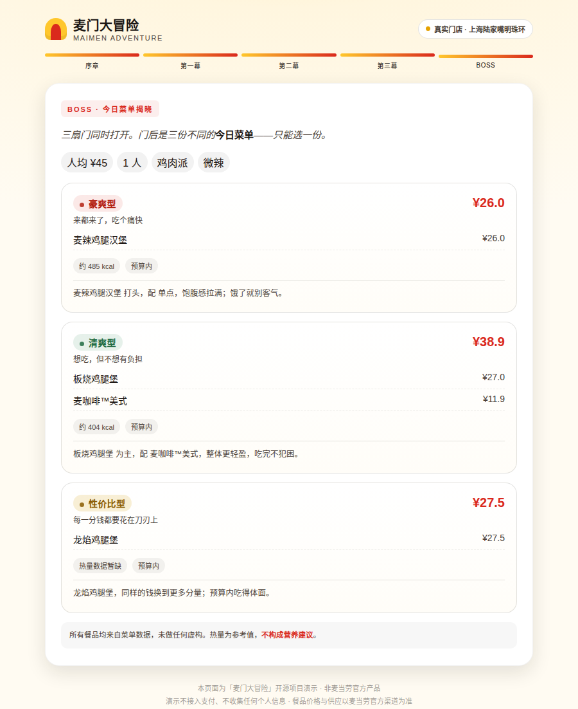
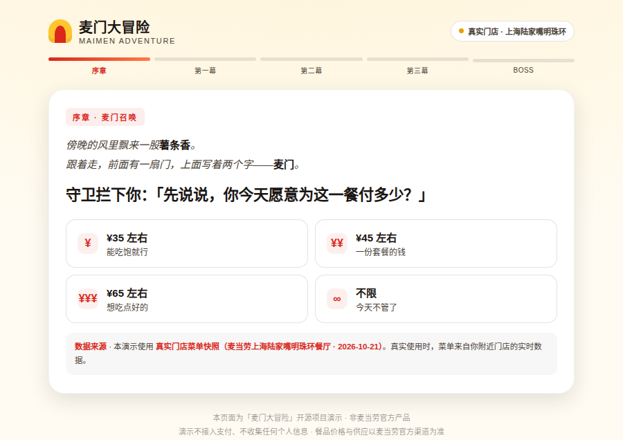
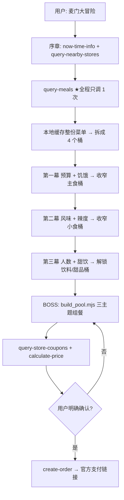

<p align="center">
  
</p>

<h3 align="center">把点餐变成一场 3 分钟的冒险</h3>

<p align="center">
  <b>真实菜单</b> · <b>4 幕剧情</b> · <b>3 张命运菜单</b> · <b>确认后下单</b>
</p>

<p align="center">
  
  
  
  
  
</p>

<p align="center"><a href="assets/demo.html"><b>▶ 打开网页 Demo（无需安装、无需 Token）</b></a></p>

---

## 这是什么

**麦门大冒险**是一个基于麦当劳 MCP 的 WorkBuddy Skill：它会读取你**附近门店的真实菜单**，然后像旁白一样带你走进四幕剧情——每一幕问你一两个问题，答完就解锁一批餐品；走到最后的 BOSS 关卡，它会给出 **3 份风格迥异的「今日菜单」**，你选定、确认，就可以直接下单。

它解决的是一件非常具体的小事：

> 站在点餐机前，看着 80 多个 SKU，脑子里只有一个想法——**「今天吃啥？」**

| 传统点餐 | 麦门大冒险 |
|---|---|
| 从头翻菜单，越翻越焦虑 | 4 个问题，3 分钟出结果 |
| 推荐要么太泛（「招牌必点」），要么太机械（「按销量排序」） | 三张卡三个人格：豪爽 / 清爽 / 性价比，总有一张像你 |
| 选完还得自己算钱 | `calculate-price` 直接给最终价，含券优惠 |
| 想下单得自己切 App | 确认后 `create-order` 返回官方支付链接 |

### 它不做什么

- **不虚构菜品**：菜单里没有的菜，一个字都不会出现
- **不接触支付**：只返回麦当劳官方支付链接，支付由你本人完成
- **不收集隐私**：不存位置、不留手机号、网页 Demo 不发起任何网络请求

---

## 效果预览

<p align="center">
  
</p>

<p align="center"><sub><b>上方为真实门店菜单</b>（麦当劳上海陆家嘴明珠环餐厅 · 88 个餐品 · 人均 ¥45 · 鸡肉派 · 微辣 · 1 人 · 要饮料）：¥26.0 / ¥38.9 / ¥27.5，三张卡全部预算内，且没有一张是靠"花光预算"凑出来的。</sub></p>

| 序章 · 麦门召唤 | BOSS · 三扇门 |
|---|---|
|  |  |

---

## 目标用户

| 用户 | 痛点 | 麦门大冒险给什么 |
|---|---|---|
| **选择困难症** | 每次点餐都要纠结 10 分钟 | 4 个问题替你收敛决策树 |
| **想尝新又怕踩雷** | 永远只点那一个堡 | 「新奇度」加权，限定/新品优先上桌 |
| **带娃 / 带朋友 / 团建** | 一人一个口味，众口难调 | 人数 + 风味派系，一次生成整桌菜单 |
| **预算敏感的学生党 / 上班族** | 想吃好又不想超支 | 「性价比型」卡片，含券比价 |
| **边控卡边想吃的人** | 想吃得开心但别太过 | 「清爽型」卡片 + 真实热量参考（**不构成营养建议**） |

---

## 安装（3 步）

### 1. 申请麦当劳 MCP Token

前往 [open.mcd.cn/mcp](https://open.mcd.cn/mcp) → 右上角「登录」（手机号验证）→「控制台」→「激活」→ 同意协议 → 复制 Token。

### 2. 配置 Connector

在 WorkBuddy 左侧栏 **【专家·技能·连接器】→【连接器】→【自定义连接器】→【配置 MCP】**，填入：

```json
{
  "mcpServers": {
    "mcd-mcp": {
      "type": "streamablehttp",
      "url": "https://mcp.mcd.cn",
      "headers": {
        "Authorization": "Bearer YOUR_MCP_TOKEN"
      }
    }
  }
}
```

> ⚠️ 把 `YOUR_MCP_TOKEN` 换成你自己的 Token。**不要把带 Token 的配置提交到 Git**（本仓库 `.gitignore` 已忽略 `mcp-config.json`）。

> 也可以直接用环境变量注入：`Authorization: Bearer ${MCD_MCP_TOKEN}`。参考 [`mcp-config.example.json`](mcp-config.example.json)。

### 3. 安装本 Skill

把本仓库的 `SKILL.md` 与 `references/`、`assets/`、`scripts/` 一起放入你的 Skill 目录（或直接 clone 本仓库到 Skill 路径）：

```bash
git clone https://github.com/smilezyl2023/maimen-adventure.git
```

然后在 WorkBuddy 里输入下面任意一句即可触发 👇

---

## 使用示例

### 触发词

> 麦门大冒险 / 帮我点个麦当劳 / 今天吃什么 / 点餐冒险 / 想吃麦当劳但不知道点什么

### 一段真实对话长这样

```text
你  ：麦门大冒险

AI  ：傍晚的风里飘来一股薯条香。
      跟着走，前面有一扇门，上面写着两个字——麦门。
      到门口了。你要用定位找最近的 3 家，还是自己报个店名？

      📍 陆家嘴中心店 · 320m · 营业中 · 可外送
      📍 正大广场店  · 850m · 营业中
      📍 八佰伴店   · 1.2km · 营业中

你  ：第一家，堂食

AI  ：（已读取门店菜单，共 34 道在售）
      守卫拦下你：「先说说，你今天愿意为这一餐付多少？」

你  ：45 左右，正常饿

AI  ：守卫侧身让开。🍔 解锁 5 道主食。
      神殿里有四座雕像：炙烤的牛、酥脆的鸡、深海的鱼、安静的素。
      你的手，会停在哪一座前面？

你  ：鸡，辣不辣都行

AI  ：🍟 解锁 9 道小食。
      「最后两件事——」要不要配饮料和甜品？

你  ：就我一个，要饮料，不要甜品

AI  ：三扇门同时打开。

      🗡️ 豪爽型 —— 来都来了，吃个痛快        ¥26.0
         · 麦辣鸡腿汉堡 ×1  ¥26.0
         约 485 kcal ｜ 预算内

      🌿 清爽型 —— 想吃，但不想有负担         ¥38.9
         · 板烧鸡腿堡 ×1    ¥27.0
         · 麦咖啡™美式 ×1   ¥11.9
         约 404 kcal ｜ 预算内

      💰 性价比型 —— 每一分钱都花在刀刃上     ¥27.5
         · 龙焰鸡腿堡 ×1    ¥27.5
         热量数据暂缺 ｜ 预算内

你  ：选第二个

AI  ：门锁上了。要不要先算一下最终价格？

你  ：算

AI  ：（calculate-price 返回）
      商品小计 ¥38.9 / 配送费 ¥0 / 优惠 ¥0 / 应付 ¥38.9
      确认下单吗？下单后会返回麦当劳官方支付链接，支付需你本人完成。

你  ：确认下单

AI  ：🎉 冒险完成。订单号 20261xxx，支付链接已生成：
      https://...（麦当劳官方）
      支付请前往官方页面完成——麦门不碰你的钱包，只负责帮你选对。
```

> 这段可以直接复现（用的是仓库里的真实门店快照）：
> ```bash
> node scripts/build_pool.mjs --card --menu assets/live-menu.json \
>   --answers '{"budget":45,"flavor":"chicken","spice":"mild","hunger":"normal","people":1,"wantDrink":true,"wantDessert":false,"careCalories":false}'
> ```
>
> 特别注意豪爽型那张：预算 ¥45，它只给了 ¥26 的一个堡。这不是"算漏了"——这家店最便宜的配餐（玉米杯）也要 ¥14.5，主食 + 配餐就是 ¥40.5 起步，而"豪爽"的定义是"够猛"，不是"点得多"。引擎宁可在预算内给一份真的猛的，也不会为了把钱花光而堆一堆凑数的东西。
>
> 三张卡**全部落在预算内**这件事本身是个约束，不是巧合：排序的第一顺位永远是"要不要用户多掏钱"，主题分和完整度都得往后站。

---

## 工作原理



**关键设计：整场只调用一次 `query-meals`。**
拿到菜单后在本地完成全部筛选，好处有三：① 不撞 600 次/分钟限流；② 3 分钟内跑完；③ 中途改答案不需要重新请求。

### 四个桶

| 桶 | 商品 | 何时解锁 |
|---|---|---|
| `mainFood` | 汉堡 / 卷 / 饭 | 第一幕答完 |
| `side` | 薯条 / 鸡块 / 鸡翅 / 沙拉 / 玉米 | 第二幕答完 |
| `drink` | 可乐 / 咖啡 / 茶 / 矿泉水 | 第三幕答完 |
| `dessert` | 甜筒 / 圣代 / 麦旋风 | 第三幕答完 |

### 三主题目标函数

三张卡不是"同一算法取前三"，而是**三种不同的目标函数**——这是它们不会雷同的原因：

```
🗡️ 豪爽  = 0.45×风味 + 0.25×辣度 + 0.30×预算 + 大份加分 + 高热量加分 − 小份扣分
🌿 清爽  = 0.40×风味 + 0.20×辣度 + 0.40×预算 + 健康向加分 − 油炸扣分 − 辣味扣分 − 热量扣分
💰 性价比 = 0.40×风味 + 0.20×辣度 + 0.40×预算 + 低价加分
```

**优先级铁律**：`用户偏好 > 预算合规 > 三卡差异化`。
宁可三张卡主食撞车，也绝不为了让卡片"看起来不同"而给出辣的菜、或是超预算的菜单。

---

## 目录结构

```
maimen-adventure/
├── SKILL.md                    # Skill 主文件（流程、降级、下单确认协议）
├── README.md                   # 你正在读的这份
├── MCP_INTEGRATION.md          # MCP 工具、调用时序、业务价值
├── CONTEST_DECLARATION.md      # 参赛声明（官方原文）
├── mcp-config.example.json     # 脱敏配置示例（仅环境变量占位符）
├── workbuddy.md                # WorkBuddy 开发对话上下文
├── references/
│   ├── story-script.md         # 4 幕台词与解锁文案
│   ├── question-mapping.md     # 答案 → 筛选条件映射表（含中文口语兜底）
│   ├── scoring-rules.md        # 打分维度与权重
│   └── mcp-calls.md            # 各 Tool 参数、错误码、降级
├── assets/
│   ├── demo.html               # 单网页 Demo（引擎由 sync_demo.mjs 注入，勿手改引擎段）
│   ├── sample-menu.json        # 示例菜单快照
│   ├── live-menu.json          # 真实门店菜单快照（mcp.mcd.cn 实拉）
│   ├── live-stores.json        # 真实门店列表
│   ├── banner.svg
│   └── screenshots/
└── scripts/
    ├── build_pool.mjs          # 组餐引擎（纯函数、零依赖）——唯一的一份引擎
    ├── mcp_adapter.mjs         # MCP 返回 → 引擎入参的适配层
    ├── nutrition.mjs           # 营养库解析（热量别名映射）
    ├── sync_live.mjs           # 从 mcp.mcd.cn 拉真实菜单，落盘成 live-*.json
    ├── sync_demo.mjs           # 把引擎注入 demo.html（--check 用于自检）
    ├── test_engine.mjs         # 引擎回归测试（191 项断言，全部来自踩过的坑）
    └── validate_skill.mjs      # 项目自检（合规红线扫描）
```

### 命令行试跑

```bash
# 用示例菜单跑一遍，输出 3 张命运菜单
node scripts/build_pool.mjs --card

# 指定答案
node scripts/build_pool.mjs --menu assets/sample-menu.json \
  --answers '{"budget":50,"hunger":"heavy","flavor":"beef","spice":"none","people":2,"wantDrink":true,"wantDessert":true}'

# 引擎回归测试（预算档位 / 偏好硬约束 / 三卡差异 / 热量 / 售罄 / 空菜单）
node scripts/test_engine.mjs

# 真实门店菜单
node scripts/build_pool.mjs --card --menu assets/live-menu.json \
  --answers '{"budget":60,"flavor":"chicken","spice":"nofilter","people":1,"wantDrink":true,"wantDessert":false}'

# 项目自检（必需文件 / Token 泄漏 / 合规红线 / Demo 引擎同步）
node scripts/validate_skill.mjs
node scripts/sync_demo.mjs --check
```

---

## 网页 Demo

[`assets/demo.html`](assets/demo.html) 是一个**单文件、零依赖**的完整冒险界面，双击即可打开。

数据源按三级回落，任何打开方式都能玩：

| 优先级 | 来源 | 触发条件 | 徽章显示 |
|---|---|---|---|
| 1 | `window.__MCD_DATA__` | 宿主页面注入实时菜单 | `LIVE · mcp.mcd.cn` |
| 2 | `assets/live-menu.json` | 同目录能 `fetch` 到（走 HTTP 时成立） | `真实门店 · 陆家嘴明珠环` |
| 3 | 内置 `SAMPLE` | 双击打开（`file://` 下 CORS 拦截第 2 级） | `SAMPLE · 快照 2026-10-21` |

> 想在线看真实门店数据：`python3 -m http.server 8000`，然后打开 `http://localhost:8000/assets/demo.html`。

**关于引擎的同步。** Demo 的引擎段不是手抄的，而是由 `scripts/sync_demo.mjs` 从 `scripts/build_pool.mjs` 整段注入（`ENGINE:BEGIN/END` 标记之间）。手工同步试过两次，两次都在一周内分叉——`isCombo` 识别、配餐保底、二件套生成、排序档位、终局校正、候选组排除，六处漏改，导致 Demo 和命令行给出不同的菜单。现在引擎只有一份源码，`node scripts/sync_demo.mjs --check` 可以直接判定是否同步。

### 把 Demo 切成实时菜单

Demo 顶部有一个数据源徽章：`SAMPLE · 快照 2026-10-21` 或 `LIVE · mcp.mcd.cn`。切换方式是注入 `window.__MCD_DATA__`：

```html
<!-- 在 demo.html 的 <script> 之前插入 -->
<script>
  // 把麦当劳 MCP query-meals 的返回原样塞进来即可
  window.__MCD_DATA__ = { categories: [ /* ... */ ] };
</script>
```

打分逻辑与 `scripts/build_pool.mjs` 同源（同一套 `themeScore` / `comboScore` 公式），因此**同一个 Skill 和网页给出的是同一份结果**，不是两套假数据。

Demo 永不发起真实下单——结算页的「确认下单」只会显示演示提示。

---

## 设计取舍

这几个问题在开发时反复纠结过，写下来供参考：

| 取舍 | 选择 | 理由 |
|---|---|---|
| 问几个问题 | **6 个，4 幕** | 点餐耐心上限约 3 分钟；再多就是在做问卷了 |
| 每幕调用 MCP 吗 | **不，只调一次 `query-meals`** | 限流友好 + 秒回 + 改答案不重请求 |
| 三个主题怎么实现 | **三套不同的目标函数，不是一套算法取 Top3** | 同一套打分取前三名，出来的永远是"三个差不多的东西" |
| 用户偏好 vs 主题人格 | **偏好是硬过滤，主题只在过滤后的池子里排** | 用户说了"不吃辣"却收到辣堡，等于这个功能是假的 |
| 预算 vs 三卡差异化 | **预算硬上限 ×1.1；差异化只在"分数差 ≤10 分"的候选里做** | 为了好看去选一个明显更差的组合，是本末倒置 |
| 预算实在装不下理想组合 | **放宽到 ×1.3 并明确告知"略超 ¥N"**，再不够就退两件套 | 宁可如实说超了几块，也不偷换成一个不痛快的搭配，更不虚标价格 |
| 热量数据 | **有就显示，没有就写"暂缺"，绝不估算** | 营养数据只作参考，不构成建议 |
| 要不要做盲盒/抽卡 | **不做** | 点餐是决策任务，随机性会削弱"帮我决定"的价值 |
| 下单 | **二次确认 + 只返回官方支付链接** | 钱的事，宁可多问一句 |
| 门店只有一款符合条件的堡 | **三张卡就共用这一款，靠配餐区分** | 编造菜单里没有的选项是欺骗；菜单窄是现实，不是 bug |

---

## 常见问题

**Q：没有 Token 能用吗？**
能。会进入**演示模式**，读取 `assets/sample-menu.json`，并明确标注「当前为快照演示数据，非实时菜单」。

**Q：为什么推荐里有我没听过的菜？**
所有菜名都来自你选定门店的 `query-meals` 返回。如果有新品你没见过，那是真的新品。

**Q：会不会自动帮我下单？**
不会。必须你在看到价格明细后**明确说「确认下单」**（"嗯"、"可以"这类模糊表达不算），才会调用 `create-order`。

**Q：热量准吗？**
来自 `list-nutrition-foods`，仅作参考，**不构成营养或医疗建议**。实际以麦当劳官方标注为准。

---

## 合规与免责

- 本项目为**麦当劳程序员创意开发大赛参赛作品**，由参赛者独立开发，**非麦当劳官方产品**。
- 餐品信息、价格、供应状态**以麦当劳官方渠道的实时结果为准**。
- 项目输出仅供参考，不构成医疗、营养或其他专业建议。
- 本仓库不包含任何真实 Token、密钥或他人个人信息；配置文件仅使用环境变量占位符。
- 不对任何其他餐饮品牌进行比较或评价。
- 网页 Demo 不收集任何个人信息，不加载任何外部脚本。

---

## License

MIT © 2026 麦门大冒险

本项目使用的麦当劳 MCP 服务受《麦当劳MCP 服务规则》约束，使用前请先阅读并同意相关条款。
